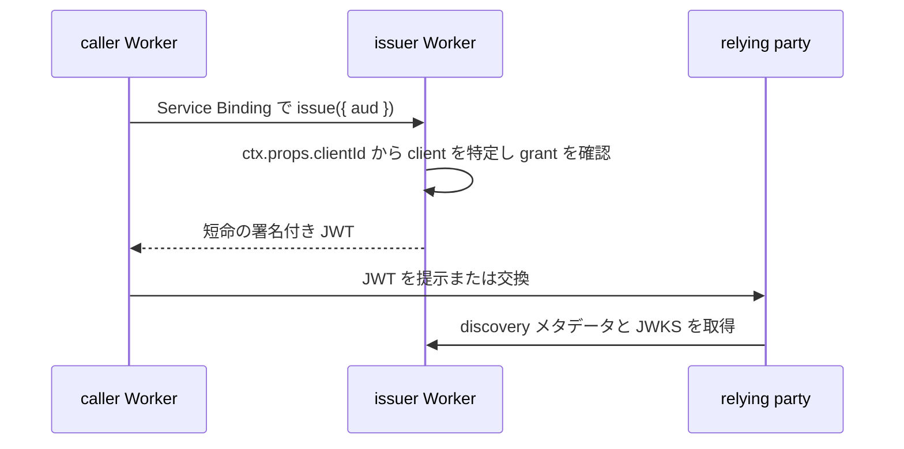

# workers-workload-identity

[English](README.md) | [日本語](README.ja.md)

Cloudflare Workers 上のサービスに、短命のワークロード ID アサーションを発行します。

caller Worker は Service Binding を通じて、**ワークロードアサーション**と呼ぶ署名付き JWT を要求します。取得したアサーションは、外部プロバイダーの token exchange や独自 API へ提示します。issuer は caller が送る値ではなく、Binding に固定した `ctx.props` から caller を識別します。公開の token endpoint はありません。

> [!WARNING]
> **アルファ版（`v0.1.0-alpha.0`）です。** Worker 間の発行と検証は、ローカルの workerd と Cloudflare のステージング環境で確認済みです。外部プロバイダー（AWS、Google Cloud、Claude API、OpenAI API）との token exchange は未検証で、本番利用を支援するバージョンはまだありません。[リリース状況](docs/ja/reference/release-status.md)を参照してください。

## 提供する機能

- 名前付きの `IssuerRpc.issue({ aud })` Service Binding エントリポイントと caller 用 SDK
- 7つのクレーム（`iss`、`sub`、`aud`、`iat`、`nbf`、`exp`、`jti`）だけを持ち、有効期間が1〜300秒のアサーション
- `/.well-known/openid-configuration` の限定的な discovery メタデータと、`/jwks.json` の公開 JWKS
- Cloudflare D1 に保存する client、audience、grant のポリシー
- 既定は RS256 署名。ES256 は relying party での検証を記録した audience ごとに使用可能
- パスキーまたは Cloudflare Access でサインインし、ロール別の権限と監査検索を備えた管理画面
- 鍵をサーバー側で生成し、先行公開し、古い鍵を廃止する Rotation Controller
- ローカル workerd と Cloudflare ステージングでの E2E テスト

## 提供しない機能

OpenID Provider ではありません。ブラウザーログイン、Authorization Code フロー、同意画面、UserInfo、リフレッシュトークン、Dynamic Client Registration、OpenID Federation 1.1 の信頼チェーンはありません。discovery メタデータは OIDC Discovery の必須項目を含まないため、完全な OpenID Provider メタデータを要求する relying party では使えません。

## 仕組み



caller が選べるのは audience だけです。subject、有効期間、署名アルゴリズム、鍵は issuer が決めます。Service Binding の `props` を編集できる主体は client ID を選べるため、デプロイ権限も信頼境界に含まれます。デプロイ前に[セキュリティモデル](docs/ja/reference/security.md)を読んでください。

## クイックスタート

Node.js 24 以上と、ルートの `package.json` に指定された pnpm 12.15.0 が必要です。

```sh
pnpm install --frozen-lockfile
pnpm test:e2e
```

E2E テストは、ローカルの workerd 上で issuer、caller、relying party を別々の Worker として起動します。Service Binding の固定 props、D1 ポリシー、RSA 署名、JWKS による検証、拒否ケース、期限切れを確認します。Cloudflare アカウントは不要で、リモート環境は変更しません。

隔離した Cloudflare アカウントへデプロイする場合は、[クイックスタート](docs/ja/getting-started.mdx)と[ステージングへのデプロイ](docs/ja/guides/deployment.md)に従ってください。

## ドキュメント

まず[ワークロード ID フェデレーションとは](docs/ja/oidc.mdx)を読み、続けて目的に応じて次のページを参照してください。

| ページ                                                             | 対象                                 |
| ------------------------------------------------------------------ | ------------------------------------ |
| [クイックスタート](docs/ja/getting-started.mdx)                    | 動作を試す                           |
| [issuer と caller の設定](docs/ja/guides/configuration.md)         | 既存の Worker を接続する             |
| [アサーションを発行する](docs/ja/guides/issuing-assertions.md)     | caller の開発者                      |
| [アサーションを検証する](docs/ja/guides/verifying-assertions.md)   | relying party の開発者               |
| [運用ガイド](docs/ja/guides/operations.md)                         | 鍵ローテーション、監視、復旧         |
| [トラブルシューティング](docs/ja/guides/troubleshooting.md)        | エラーコードと代表的な障害           |
| [セキュリティモデル](docs/ja/reference/security.md)                | 脅威と信頼境界                       |
| [プロバイダー対応状況](docs/ja/reference/provider-support.mdx)     | 外部プロバイダーの検証状況           |
| [用語集](docs/ja/reference/glossary.md)                            | ドキュメントで使う用語               |

コントリビューター向けの設計資料は [docs/ja/design](docs/ja/design/) にあります。英語版が正本で、[docs/](docs/index.mdx) にあります。

## リポジトリ構成

| パス                                                                            | 内容                                                         |
| ------------------------------------------------------------------------------- | ------------------------------------------------------------ |
| `apps/issuer-worker`                                                            | 発行 RPC、discovery メタデータ、JWKS、D1 と JOSE のアダプタ   |
| `apps/admin-worker`、`apps/admin-ui`                                            | 管理 API と、それが配信する React の管理画面                  |
| `apps/rotation-worker`                                                          | Rotation Controller とその Workflow                          |
| `apps/smoke-worker`、`apps/smoke-receiver`                                      | ステージングと E2E 用の caller と relying party              |
| `apps/docs`                                                                     | ドキュメントサイトの設定。本文は `docs/` にあります           |
| `packages/client`                                                               | caller 用 SDK と Service Binding 設定ヘルパー                |
| `packages/contracts`                                                            | Worker と UI で共有する、ブラウザーに公開できる Zod 契約      |
| `packages/domain-identity`、`packages/domain-keys`、`packages/domain-operators` | プラットフォームに依存しない業務ルール                       |
| `migrations/`                                                                   | ポリシー、鍵、管理用の D1 マイグレーション                   |
| `examples/`                                                                     | プロバイダー実機検証用の Terraform と Worker の例             |

caller 用 SDK は npm に公開していません。`pnpm client:build` でソースからビルドしてください。

## コントリビューション

開発環境、必須の検査、文書の規則は [CONTRIBUTING.ja.md](CONTRIBUTING.ja.md) にあります。[行動規範](CODE_OF_CONDUCT.md)に従ってください。主な変更は[変更履歴](CHANGELOG.md)に記録します。

## セキュリティ

脆弱性を公開 issue で報告しないでください。[SECURITY.ja.md](SECURITY.ja.md) の手順に従ってください。質問や不具合報告は [SUPPORT.ja.md](SUPPORT.ja.md) を参照してください。

## ライセンス

[MIT](LICENSE)
