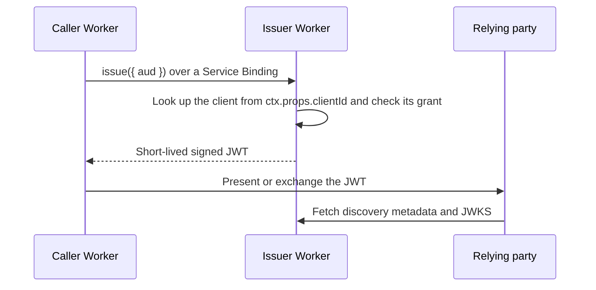

# workers-workload-identity

[English](README.md) | [日本語](README.ja.md)

Short-lived workload identity assertions for services running on Cloudflare Workers.

A caller Worker requests a signed JWT, called a **workload assertion**, through a Service Binding. It presents the assertion to an external provider's token exchange or to a private API. The issuer identifies the caller from the binding's fixed `ctx.props`, not from anything the caller sends, and exposes no public token endpoint.

> [!WARNING]
> **Alpha (`v0.1.0-alpha.0`).** Issuance and verification between Workers pass in local workerd and in a Cloudflare staging environment. Token exchange with external providers (AWS, Google Cloud, Claude API, OpenAI API) has not been verified, and no version is supported for production use. See [release status](docs/reference/release-status.md).

## What it provides

- A named `IssuerRpc.issue({ aud })` Service Binding entrypoint and a caller SDK
- Assertions with exactly seven claims (`iss`, `sub`, `aud`, `iat`, `nbf`, `exp`, `jti`) and a lifetime of 1 to 300 seconds
- Limited discovery metadata at `/.well-known/openid-configuration` and a public JWKS at `/jwks.json`
- Client, audience, and grant policy stored in Cloudflare D1
- RS256 signing by default, and ES256 per audience once a relying party has been verified with it
- An admin console with passkey or Cloudflare Access sign-in, role-based access, and audit search
- A Rotation Controller that generates keys server-side, prepublishes them, and retires old keys
- Local workerd and Cloudflare staging end-to-end tests

## What it does not provide

This is not an OpenID Provider. It has no browser login, Authorization Code flow, consent, UserInfo, refresh tokens, Dynamic Client Registration, or OpenID Federation 1.1 trust chains. The discovery metadata omits fields that OIDC Discovery requires, so relying parties that need complete OpenID Provider metadata cannot use it.

## How it works



The caller chooses only the audience. The issuer fixes the subject, lifetime, signing algorithm, and key. Anyone who can edit a Service Binding's `props` can select a client ID, so deployment permissions are part of the trust boundary. Read the [security model](docs/reference/security.md) before deploying.

## Quick start

Requires Node.js 24 or later and pnpm 12.15.0, as declared in the root `package.json`.

```sh
pnpm install --frozen-lockfile
pnpm test:e2e
```

The end-to-end suite starts separate issuer, caller, and relying-party Workers in local workerd. It covers fixed Service Binding props, D1 policy, RSA signing, JWKS verification, denial cases, and expiry. It needs no Cloudflare account and changes no remote environment.

To deploy to an isolated Cloudflare account, follow the [quickstart](docs/getting-started.mdx) and the [staging deployment guide](docs/guides/deployment.md).

## Documentation

Start with [What is workload identity federation?](docs/oidc.mdx), then:

| Topic                                                               | For                                    |
| ------------------------------------------------------------------- | -------------------------------------- |
| [Quickstart](docs/getting-started.mdx)                              | Running the project                    |
| [Configure the issuer and caller](docs/guides/configuration.md)     | Connecting an existing Worker          |
| [Issue an assertion](docs/guides/issuing-assertions.md)             | Caller developers                      |
| [Verify an assertion](docs/guides/verifying-assertions.md)          | Relying-party developers               |
| [Operations guide](docs/guides/operations.md)                       | Key rotation, monitoring, and recovery |
| [Troubleshooting](docs/guides/troubleshooting.md)                   | Error codes and common failures        |
| [Security model](docs/reference/security.md)                        | Threats and trust boundaries           |
| [Provider support](docs/reference/provider-support.mdx)             | External provider status               |
| [Glossary](docs/reference/glossary.md)                              | Terms used in the documentation        |

Design documents for contributors are under [docs/design](docs/design/). All documentation is also available in [Japanese](docs/ja/index.mdx).

## Repository layout

| Path                                                                            | Contents                                                   |
| ------------------------------------------------------------------------------- | ---------------------------------------------------------- |
| `apps/issuer-worker`                                                            | Issuance RPC, discovery metadata, JWKS, D1 and JOSE adapters |
| `apps/admin-worker`, `apps/admin-ui`                                            | Admin API and the React admin console it serves            |
| `apps/rotation-worker`                                                          | Rotation Controller and its Workflow                       |
| `apps/smoke-worker`, `apps/smoke-receiver`                                      | Test caller and relying party for staging and E2E tests    |
| `apps/docs`                                                                     | Documentation site configuration; content lives in `docs/` |
| `packages/client`                                                               | Caller SDK and Service Binding configuration helper        |
| `packages/contracts`                                                            | Browser-safe Zod contracts shared by Workers and the UI    |
| `packages/domain-identity`, `packages/domain-keys`, `packages/domain-operators` | Business rules with no platform dependencies               |
| `migrations/`                                                                   | D1 migrations for the policy, key, and admin databases     |
| `examples/`                                                                     | Terraform and Worker examples for live provider validation |

The caller SDK is not published to npm. Build it from source with `pnpm client:build`.

## Contributing

Read [CONTRIBUTING.md](CONTRIBUTING.md) for setup, required checks, and documentation rules, and follow the [Code of Conduct](CODE_OF_CONDUCT.md). Notable changes are recorded in the [changelog](CHANGELOG.md).

## Security

Do not report vulnerabilities in public issues. Follow [SECURITY.md](SECURITY.md). For questions and bug reports, see [SUPPORT.md](SUPPORT.md).

## License

[MIT](LICENSE)
