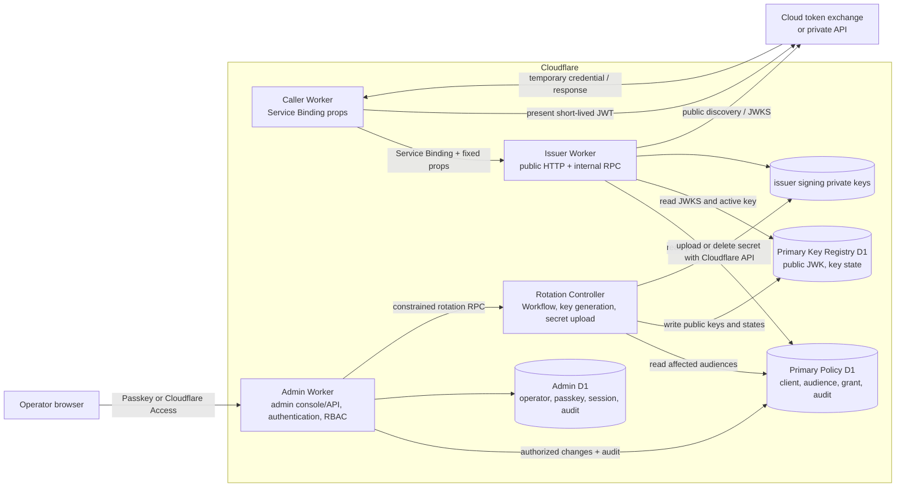
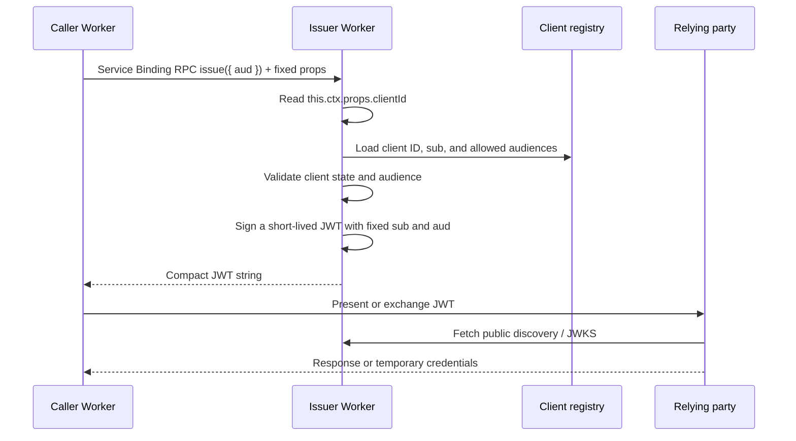

# System architecture

**Status:** Partially implemented. The initial implementation passes local and staging validation. Production acceptance and live provider validation remain incomplete. See the [requirements](./requirements.md), [technology decisions](./technology-decisions.md), [admin console](./admin-console.md), [key lifecycle](./key-management.md), and [Rotation Controller](./rotation-controller.md).

## Components



The issuer's public HTTP handler serves discovery and JWKS and routes `/admin/` to a separate Admin Worker. Issuance is a named Cloudflare RPC entrypoint reachable only through a Service Binding. The caller binding fixes `props.clientId`, which the entrypoint reads from `this.ctx.props`. No URL path on the public handler issues an assertion.

The Admin Worker serves the admin console and API at `/admin/` on the issuer's public hostname while remaining a separate Worker. It authenticates against Admin D1, enforces local RBAC, and changes Policy D1. The issuer reads primary Policy D1 for every request, so client disablement and grant removal affect the next issuance. The issuer has no Admin D1 binding, and the Admin Worker receives neither a signing key nor issuance authority. An independent Rotation Controller generates keys and uploads them as issuer secrets. Key Registry D1 is authoritative for public JWKs and key state, and the Admin Worker cannot write it. D1 bindings are not assumed to provide table-level read-only permissions, so the issuer contains no policy or key-registry mutation path and deployment permissions remain separate. See [Public host and root path](./domain-routing.md), [admin console](./admin-console.md), and [Rotation Controller](./rotation-controller.md).

Cloudflare passes Service Binding `props` to the target Worker as `ctx.props`, and configuration permissions protect those values. The props are not a secret or HTTP header and do not automatically prove Worker identity. Every principal that can configure a binding is part of the trust boundary. Central CI is not required if the permissions of in-account administrators, editors, and API tokens can be restricted. Evaluate external attackers separately from in-account principals that can edit or deploy a Worker. Live tests must confirm the actual rejection behavior for the combination of props, caller binding configuration, and per-Worker permissions, as well as entrypoint visibility and same-Worker handler separation. If needed, split issuance and JWKS publication into separate Workers. See [Cloudflare Context](https://developers.cloudflare.com/workers/runtime-apis/context/), [Service Bindings](https://developers.cloudflare.com/workers/runtime-apis/bindings/service-bindings/), and [Workers permissions](https://developers.cloudflare.com/workers/authorization/workers/).

A fictitious caller configuration:

```json
{
  "services": [
    {
      "binding": "OIDC_ISSUER",
      "service": "oidc",
      "entrypoint": "IssuerRpc",
      "props": { "clientId": "example-caller-prod" }
    }
  ]
}
```

Do not put a subject or allowed audiences in props; the issuer registry owns them. The current RPC input contains only the desired `aud`. A `ctx.exports` loopback binding can set props dynamically, so public-handler loopback issuance and giving an issuer stub to untrusted code are forbidden.

## Issuance sequence



Missing or invalid props, registry read failure, and an audience without a grant all fail issuance. The caller keeps the JWT in memory only as long as necessary. A unique `jti` identifies the JWT but does not prevent replay unless the relying party maintains additional state.

## Trust boundaries

1. **Caller → issuer:** A same-account Service Binding is the transport. A fixed `ctx.props.clientId` is a caller identifier protected by deployment configuration. The issuer derives subject and allowed audiences from its own registry. Callers cannot choose another caller's `sub` or an arbitrary `aud` through RPC arguments. A principal that can edit the binding or props can select another client ID and is therefore inside the trust boundary.
2. **Issuer → public web:** `/.well-known/openid-configuration` and `/jwks.json` are public. Admin data and private keys are not.
3. **Issuer → relying party:** The relying party preregisters the issuer and allows a purpose-specific audience and subject. Signature verification alone does not grant permission.
4. **Organization → OSS:** Public source is separate from deployment configuration and secrets. The organization retains real client registrations.

## Data and secrets

| Data                                            | Preferred location                 | Exposure                                                             |
| ----------------------------------------------- | ---------------------------------- | -------------------------------------------------------------------- |
| Issuer signing private key                      | Issuer Worker secret binding       | Issuer runtime only                                                  |
| Public key, `kid`, and state                    | Key Registry D1 and JWKS           | Only public components are published; Controller writes the registry |
| Caller `props.clientId`                         | Service Binding deployment config  | Changeable by deploy principals; not a secret                        |
| Clients, audiences, grants, and mutation audit  | Environment-specific Policy D1     | Admin Worker writes; issuer reads policy during issuance             |
| Operators, authentication data, and admin audit | Environment-specific Admin D1      | Admin Worker only                                                    |
| Cloudflare API token                            | Rotation Controller secret binding | Controller only; its code calls only the configured issuer script    |
| Issued JWT                                      | Caller request memory              | Presented only to the intended relying party                         |

Policy D1 is authoritative for client registration. The initial release needs no caller authentication key or replay store. The issuer generates each `jti` uniquely.

## Relying-party integrations

### AWS

Register an IAM OIDC provider in the AWS account and restrict the role trust policy by issuer, `aud`, and `sub`. The caller presents the issuer JWT to STS `AssumeRoleWithWebIdentity` and uses the returned temporary credentials to call AWS APIs. The OIDC provider and role are relying-party configuration; the issuer core does not need to store AWS-specific role ARNs. Live testing must establish the discovery document, token claims, and key formats that AWS actually accepts. See [AWS IAM](https://docs.aws.amazon.com/IAM/latest/UserGuide/id_roles_providers_create_oidc.html) and [AWS STS](https://docs.aws.amazon.com/STS/latest/APIReference/API_AssumeRoleWithWebIdentity.html).

### Google Cloud

Configure a Workload Identity Pool/Provider with the issuer, allowed audience, attribute mapping, and conditions. The caller adapter exchanges the JWT for short-lived Google Cloud credentials. The default audience is the target provider's fully qualified URI; register that exact value as an allowed caller `aud` in the issuer. See [Google Cloud WIF](https://docs.cloud.google.com/iam/docs/workload-identity-federation-with-other-providers).

### Claude API

Configure Anthropic's federation issuer, federation rule, service account, and workspace. The caller adapter or SDK exchanges the issuer JWT for a short-lived access token at Claude's token endpoint and presents that token to the API. Validate `aud` and `sub` matching, scopes, and public-key retrieval and refresh behavior against the live service. Never send the issuer JWT directly as the Claude API bearer token. See [Claude WIF](https://platform.claude.com/docs/en/manage-claude/workload-identity-federation).

### OpenAI API

Configure an OpenAI Platform Workload Identity Provider, service-account mapping, and project permissions. The caller adapter exchanges the issuer JWT for a short-lived access token at OpenAI's token endpoint and presents that token to the API. Because the official documentation currently limits which OIDC issuers are accepted, compatibility with this issuer is not guaranteed and requires provider confirmation and live testing. This is separate from Codex or ChatGPT federation. See [OpenAI WIF](https://developers.openai.com/api/docs/guides/workload-identity-federation) and [token exchange](https://developers.openai.com/api/reference/workload-identity-federation).

### Microsoft Entra

Register issuer, subject, and audience in a federated identity credential for the target app or managed identity. The caller adapter exchanges the JWT at the Microsoft identity platform token endpoint. Grant permissions on the relying party; the issuer does not infer or confer those permissions. See [Microsoft Entra workload federation](https://learn.microsoft.com/en-us/entra/workload-id/workload-identity-federation).

### Private APIs

The API verifies the JWKS signature, exact `iss`/`aud`/`sub` values, and time claims, then applies its own authorization rules. Assign a different `aud` to direct-API tokens so they cannot be confused with cloud-exchange assertions. If the token is described as a standard JWT access token, it must satisfy all RFC 9068 requirements.

## Rotation and emergency response

Normal rotation follows: generate a key in the Controller, prepublish its JWKS entry, confirm that the version serving 100% of traffic contains the new secret, confirm relying-party key retrieval and wait for caches, activate new signing, wait for old JWTs to expire, then remove the old key. Relying-party cache behavior is measured independently for AWS STS, API Gateway, Google Cloud, Entra, and each private API. Audience policy selects the signing algorithm. Avoid removing a public key too early and JWKS mismatches between old and new Worker versions. See [signing algorithms and key lifecycle](./key-management.md).

After compromise, stop the old key and activate a replacement. Signed JWTs and exchanged credentials may remain usable, so disable relying-party trust policies, federated credentials, permissions, or sessions as necessary. Define who may reduce availability during an emergency and how to reach them before operations begin.

## Remaining validation

- Service Binding `props` permissions restricted as intended in a real environment with in-account administrators, per-Worker editors, and API tokens, verified independently of whether central CI is used
- Same-host `/admin/` routing and exclusive passkey versus Cloudflare Access configuration; Access step-up still requires a separate origin
- Real relying-party discovery, JWKS retrieval, and cache behavior
- Alignment between OIDC-shaped discovery and each provider's requirements

Named RPC isolation from HTTP, RS256 with `jose`, Worker-to-Worker local tests, client disablement and grant removal in D1 taking effect on the next issuance, and the staging flow now have implementation evidence. The remaining items stay gates in the [acceptance criteria](./acceptance.md).
