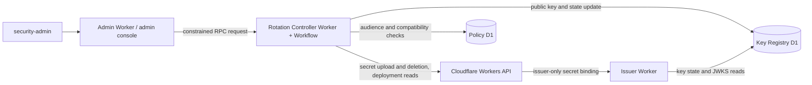

---
sidebar:
  label: Rotation Controller
---

# Key generation and automated rotation from the admin console

**Status:** Implemented. The Rotation Controller (`apps/rotation-worker`) exposes the RPC methods `listKeys`, `plan`, `propose`, `approve`, `control`, `immediateActivate`, `configureSchedule`, `activate`, and `retire`. Its Workflow uploads the secret, prepublishes the JWK, waits, verifies the deployment and relying-party gates, activates the key, and later removes the old key. The detailed state machine under [Target Controller state machine](#target-controller-state-machine) remains target design, and the Cloudflare API, `jose`, and RSA/EC key-generation paths still need testing against a real account.

Rotation runs use the states `draft`, `secret-staging`, `published`, `active`, `removed`, and `failed`. Keys use `prepared`, `active`, `verifying`, and `removed`. Workflow execution status is shown separately from key state.

## Decision and boundary

The admin console offers **Start rotation** (or **Propose rotation**), **Generate key and start**, and **Enable scheduled rotation**. These controls start server-side jobs. The browser never generates, receives, or displays private key material.

Workers Web Crypto can generate keys with `generateKey()`. Installing the generated private key as an issuer Worker secret requires exporting it once and sending it to the Cloudflare API, so this design cannot claim that a key is never exportable. Deployments that require non-exportable keys must replace the signer with an external KMS `Sign` adapter. See [Workers Web Crypto](https://developers.cloudflare.com/workers/runtime-apis/web-crypto/) and the [Worker Secrets API](https://developers.cloudflare.com/api/resources/workers/subresources/scripts/subresources/secrets/methods/update/).

## Components

- **Admin Worker:** authenticates operators, enforces RBAC, records approvals, and displays job state. It has no Worker-update API token, private key, or Key Registry D1 binding. The admin console cannot submit arbitrary key material, account or script names, or Cloudflare API request bodies.
- **Rotation Controller:** accepts RPC only through a Service Binding whose fixed `ctx.props` are `{ "caller": "admin" }`, and returns 404 from its public HTTP handler. These props show that the caller holds that binding, not that it is the Admin Worker: the generated staging configuration also gives the smoke Worker this binding for tests. Grant the binding only to the Admin Worker in production. It reads Policy D1, writes Key Registry D1, and invokes a Workflow. Input schemas and state preconditions constrain algorithms, wait periods, concurrency, and `kid` generation. A fixed five-minute Worker Cron Trigger evaluates schedules.
- **Key Registry D1:** is the source of truth for public JWKs, `kid`, `alg`, secret-binding names, lifecycle state, publication and activation times, deployment versions, run IDs, and gate evidence. Only the issuer and the Controller bind it. The Admin Worker reads public status through the Controller's `listKeys` RPC. It never contains private keys or Cloudflare API tokens.
- **Issuer Worker:** reads current policy and key state, reads the actual private key only from its own secret binding, and builds JWKS from the registry. New issuance fails closed on read errors or key mismatch.

The target script is fixed in code by the `CF_ISSUER_SCRIPT` setting; the Controller calls Cloudflare API paths only under that script. The API token itself is not limited to that Worker: the staging procedure asks for an account-level token with **Workers Scripts Edit** and **Read** permissions. Treat the token as a high-privilege credential equivalent to authority to update any Worker in the account, and narrow its scope further where Cloudflare allows it.

Uploading a secret creates and deploys a new issuer version. The Controller never calls the Deployment API to create or change deployments. It only reads deployments and versions (`GET deployments`, `GET versions`) to verify that a single version serves 100% of traffic and has the new key's binding. Retirement only deletes the old secret. Keeping the old registry key `active` until verification passes separates staging a private key from starting to sign with it. Coordinate rotation with ordinary deployments. See the [Worker Secrets API](https://developers.cloudflare.com/api/resources/workers/subresources/scripts/subresources/secrets/methods/update/).

## Admin console operations and state

The admin console shows keys, runs, gate evidence, and action history, and provides the operations below. Starting, approving, controlling, scheduling, and immediate rotation require step-up authentication (Cloudflare Access) or recent authentication (passkey); proposing does not.

| Operation or view    | Required role                                                                  | Behavior                                                                                                                                                                                                 |
| -------------------- | ------------------------------------------------------------------------------ | -------------------------------------------------------------------------------------------------------------------------------------------------------------------------------------------------------- |
| Start rotation       | `security-admin`                                                               | `plan` creates a run directly. The plan sets the algorithm, `prepublishSeconds` (60 to 2,592,000), and `retirementGraceSeconds` (300 to 2,592,000).                                                      |
| Propose and approve  | `operator` or `security-admin` proposes; a different `security-admin` approves | `propose` stores the plan; `approve` creates the run. The approver must be a `security-admin` other than the proposer. A `security-admin` can also start a rotation directly without a proposal.         |
| Pause, resume, retry | `security-admin`                                                               | `control` requires a reason. It is rejected for runs in `removed`, `failed`, or `secret-staging`. Retry restarts only an errored or terminated Workflow, or starts a missing Workflow for a `draft` run. |
| Configure automation | `security-admin`                                                               | `configureSchedule` sets the settings listed in [Automation settings](#automation-settings). Automation is disabled by default.                                                                          |
| Immediate rotation   | `security-admin`                                                               | `immediateActivate` requires a published candidate, its expected `kid`, a reason, and an explicit acknowledgement of the cache risk.                                                                     |
| View history         | `viewer` or higher                                                             | Shows keys, runs, Workflow status, schedules, proposals, gate evidence, and actions.                                                                                                                     |

A run left in `secret-staging` cannot be retried, because the outcome of the secret upload is unknown. It requires manual recovery rather than a second key upload. A definite authentication rejection (HTTP 401 or 403) before a key exists marks the run `failed`; correct the token and start a new rotation.

“Generation succeeded” means that both the secret upload and the public-key registration completed. “Rotation succeeded” means that issuance, JWKS, and relying-party verification all passed. A button click or a D1 work record alone is not success.

## Automation settings

The schedule schema contains these fields per algorithm:

| Field                    | Constraint                                      |
| ------------------------ | ----------------------------------------------- |
| `algorithm`              | `RS256` or `ES256`                              |
| `enabled`                | Boolean. Disabled by default                    |
| `intervalDays`           | 7 to 365                                        |
| `nextRunAt`              | At least 60 seconds in the future when enabling |
| `prepublishSeconds`      | 60 to 2,592,000                                 |
| `retirementGraceSeconds` | 300 to 2,592,000                                |

A notification target and an approval requirement for scheduled runs are not implemented; they are future work.

Enabling a schedule requires an active key for the algorithm, at least one audience that uses it, and, for every such audience, a recorded JWKS cache limit, `prepublishSeconds` of at least that limit plus 60 seconds, and relying-party confirmations. On each tick, the scheduler skips an algorithm while any of its runs is neither `removed` nor `failed`. If the confirmations are no longer satisfied, the scheduler disables the schedule, records the reason on the schedule and in the action history, and emits a structured log; the admin console shows the reason. A D1 batch commits the run and the next execution time together. A crash before Workflow creation is recovered using the same run ID.

## Target Controller state machine

The following is a target design for stronger recovery and observability, not the current run-state model. The completed lifecycle is `draft → secret-staged → published → issuer-deployed → cache-wait → active → retiring → removed`. Every transition uses the expected previous state and a unique job ID as preconditions. A new job for an `alg` with an unfinished job is rejected, so simultaneous manual and scheduled triggers cannot activate twice.

From `published` until `removed`, JWKS contains both old and new public keys. The signing key moves exactly once, at the transition to `active`. Configure and verify the prepublication interval separately from the post-activation retention interval, and do not remove the old key early when a rollout runs long. See [Public key transition period](./key-management.md#public-key-transition-period).

1. Generate a key with Web Crypto: 3072-bit RSA for RS256 and P-256 for ES256. The Controller assigns a fresh `kid` and binding name. Export and upload the private key server-side, and never retain private components in logs, Workflow payloads or step results, D1, or the browser. If a failure occurs after the Cloudflare API succeeds, compare or discard the candidate and retry with a new `kid`; never overwrite a different key under the same `kid`.
2. Move to `published`, verify from external HTTPS that JWKS includes both keys, and continue issuing with the old key.
3. Confirm that the Worker version containing the new secret serves 100% of traffic, and verify the runtime key pair. Pause if an ordinary code deployment overlaps.
4. Read every audience using the `alg` from Policy D1. Satisfy each relying party's verified mixed-JWKS and cache wait, then re-read the audience set and version immediately before activation. A new unverified audience, missing monitoring, JWKS mismatch, or unknown deployment state blocks automatic activation.
5. In a conditional D1 transaction, set the new key to `active`, the old key to `verifying`, and advance the manifest revision. Integration tests must show that JWKS and issuance cannot observe a split state. Monitor issued `kid` values and external exchanges; on abnormal results, keep both public keys available while returning to a safe signing state.
6. Establish a conservative upper bound on the last old-key issuance from reservation expiry and activation-transaction concurrency. Remove the old public key only after that bound plus the maximum JWT lifetime and clock skew, and delete the old secret. If the upper bound cannot be verified, require manual removal.

Use Cloudflare Workflows for multi-hour waits and retries. Workflows support `sleep` and per-step retries, but private keys must never appear in step return values or durable state. Because Cloudflare API calls and D1 updates are not one distributed transaction, every step must be idempotent and recovery must detect orphaned secrets or versions, publication-only keys, and deployment-only keys. See [Workflows](https://developers.cloudflare.com/workflows/) and [sleep and retry](https://developers.cloudflare.com/workflows/build/sleeping-and-retrying/).

## Target conditions for automation

Scheduled triggers and configurable automation are implemented. The following remain production release gates.

- The initial mode is **manual**. Enable automatic rotation only for an `alg` whose relying parties have passed real mixed-JWKS, refetch, cache-bound, and post-activation exchange tests.
- A fixed five-minute Worker Cron Trigger drives the schedule. Each algorithm's interval, next run, and enabled state live in Key Registry D1; the admin console never rewrites Cloudflare cron configuration. Record execution dates in UTC and begin preparation well before any operational deadline. See [Workflow schedules](https://developers.cloudflare.com/workflows/build/trigger-workflows/).
- Automation passes through generation, prepublication, activation, and retirement gates. Missing evidence stops the job and continues old-key issuance. Emergency rotation for a suspected compromise is a separate procedure.
- A leaked or abused Controller token can impersonate or stop the issuer. Token storage, resource scope, audit, emergency revocation, and periodic replacement are production release gates.

## Evidence still required

1. RSA-3072 and P-256 generation time and CPU use in Workers, plus JWK compatibility with `jose`.
2. Worker version creation and deployment behavior after secret uploads and deletions. Test `secret_key` bindings, but do not require them for the initial design.
3. Propagation time from Key Registry D1 updates to all public JWKS responses and the next issuance, plus fail-closed read behavior.
4. The narrowest Controller-token scope Cloudflare allows, mutual exclusion with ordinary CI deployments, and Cloudflare API auditability.
5. Recovery from Workflow retries, interruption, and duplication without persisting or logging private key material.
6. A provable upper bound on old-key issuance during concurrent activation, and an automatic-removal stop when that bound cannot be established.

## Immediate rotation boundaries

Immediate rotation skips the prepublication wait, the audience cache checks, and the relying-party confirmation checks (exchange, mixed JWKS, and the ES256 confirmation). The deployment and JWKS verification and the old-key retirement gates still apply. It does not revoke credentials that a relying party has already exchanged. A paused Workflow still requires an explicit resume after immediate rotation.

## Audience confirmations gate activation

Relying-party confirmations use the audience fields `exchange_verified`, `mixed_jwks_verified`, and `jwks_cache_seconds`. Automation and normal key replacement require successful authentication and acceptance of old and new keys for every audience using the algorithm, plus a sufficient cache wait. ES256 also requires its dedicated confirmation. Checks run when a schedule is enabled and on each due tick; normal activation re-reads the current confirmations before and after the deployment checks. The Controller does not perform external token exchanges itself.

The first key for an algorithm can be activated before relying-party testing, because the old/new-key confirmations do not apply when there is no old key. The cache-limit check still applies, and automation still requires an active key.
