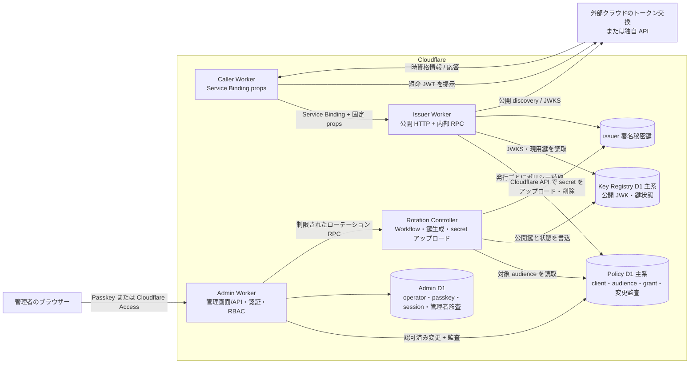
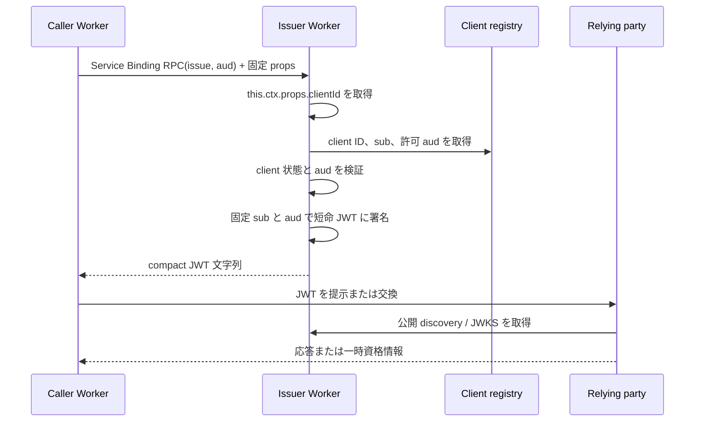

# システムアーキテクチャ

**状態:** 一部実装。初期実装はローカルとステージングの検証を通過している。本番受け入れとプロバイダーの実機検証は未完了である。詳細は [要件定義](./requirements.md)、[技術選定](./technology-decisions.md)、[管理画面](./admin-console.md)、[鍵ライフサイクル](./key-management.md)、[Rotation Controller](./rotation-controller.md) を参照する。

## 構成



issuer Worker の公開 HTTP handler は discovery/JWKS を配信し、`/admin/` を別の Admin Worker へ中継する。発行メソッドは Cloudflare の named RPC entrypoint に置き、Service Binding 経由でのみ到達できる構成にする。caller の Binding 設定に固定 `props.clientId` を置き、発行 entrypoint は `this.ctx.props` を参照する。公開 handler の URL パスで発行を実装しない。

Admin Worker は issuer と同じ公開ホストの `/admin/` で管理画面と API を配信するが、独立した Worker として Admin D1 の管理者情報で認証とローカル RBAC を行い、Policy D1 を更新する。issuer は発行ごとに Policy D1 主系からポリシーを読み、停止・grant 解除を次の発行に反映する。issuer に Admin D1 Binding を与えず、Admin Worker に issuer の秘密鍵や発行権限を渡さない。鍵の生成と issuer secret としてのアップロードは独立した Rotation Controller が担い、鍵状態と公開 JWK は Admin Worker が書けない Key Registry D1 を正本とする。D1 binding にテーブル単位の読み取り専用権限があるとは仮定せず、issuer に各 D1 の書込コードを置かないこととデプロイ権限の分離で事故を減らす。[公開ホストとルートパス](./domain-routing.md)、[管理画面](./admin-console.md)、[Rotation Controller](./rotation-controller.md) を参照する。

Cloudflare は Service Binding の `props` が呼び出し先の `ctx.props` に渡り、その設定権限が制御されると説明している。`props` は秘密文字列でも HTTP header でもなく、Worker の身元が自動的に証明されるわけでもない。Binding を設定・変更できる全主体を信頼境界に含める。同一 account の管理者・編集者・API token の権限を制限できれば、中央 CI は必須ではない。アカウントに入れない外部者と、アカウント内で Worker を編集・デプロイできる主体を分けて評価する。Cloudflare の `ctx.props` 説明と caller 側の Binding 設定・Worker 単位権限の組み合わせについて、実際の拒否動作を実機試験で確認する。RPC entrypoint の可視性、同一 Worker 内の handler 分離も確認する。必要なら発行 Worker と公開鍵配信 Worker を分離する。[Cloudflare Context](https://developers.cloudflare.com/workers/runtime-apis/context/)、[Service Bindings](https://developers.cloudflare.com/workers/runtime-apis/bindings/service-bindings/)、[Workers 権限](https://developers.cloudflare.com/workers/authorization/workers/) を参照する。

caller の設定例（値は架空）:

```json
{
  "services": [
    {
      "binding": "OIDC_ISSUER",
      "service": "oidc",
      "entrypoint": "IssuerRpc",
      "props": { "clientId": "example-caller-prod" }
    }
  ]
}
```

`props` に `sub` や許可 `aud` を入れず、issuer 側の登録情報から決める。現行の caller が RPC 引数で渡せるのは希望 `aud` だけである。`ctx.exports` の loopback binding では `props` を動的に指定できるため、公開 handler からの loopback 発行と、信頼できないコードへの発行 RPC stub の受け渡しを禁止する。

## 発行シーケンス



`ctx.props` の欠落・不正、登録情報の取得失敗、未許可 `aud` は発行失敗とする。JWT は caller メモリ上で必要最小限の時間だけ保持する。発行された JWT の `jti` は識別子であり、relying party が別途再利用防止を実装しない限り bearer JWT の再提示を防がない。

## 信頼境界

1. **caller → issuer:** Service Binding は同一 account 内の到達経路、固定 `ctx.props.clientId` は設定権限で保護された caller ID。issuer はその client ID に対応する `sub` と許可 `aud` を自身の登録情報から決める。caller に別 caller の `sub` や任意の `aud` を RPC 引数で指定させない。ただし Binding/`props` を変更できる主体は client ID を設定し直せるため、その主体を信頼境界に入れる。
2. **issuer → 公開 Web:** `/.well-known/openid-configuration` と `/jwks.json` は公開情報。管理情報や秘密鍵は公開しない。
3. **issuer → relying party:** relying party は issuer を事前に信頼登録し、用途に固有の `aud` と `sub` を許可する。JWKS の署名検証だけでは権限は決まらない。
4. **組織 → OSS:** 公開ソースと実デプロイ設定・秘密情報を分離する。発行クライアントの登録データは組織側が保持する。

## データと秘密情報の配置

| データ                           | 配置の第一候補                        | 露出条件                                                         |
| -------------------------------- | ------------------------------------- | ---------------------------------------------------------------- |
| issuer 署名秘密鍵                | issuer Worker secret binding          | issuer 実行環境のみ                                              |
| issuer 公開鍵・`kid`・状態       | Key Registry D1 と JWKS               | 公開成分のみ公開可。Registry は Controller が更新                |
| caller の `props.clientId`       | Service Binding のデプロイ設定        | 設定権限を持つ主体が変更可能。秘密ではない                       |
| client/audience/grant・変更監査  | 環境ごとの Policy D1                  | Admin Worker が書込、issuer は発行時にポリシーのみ読取           |
| operator・認証データ・管理者監査 | 環境ごとの Admin D1                   | Admin Worker のみ利用                                            |
| Cloudflare API token             | Rotation Controller の secret binding | Controller のみ利用。コードは設定された issuer script だけを呼ぶ |
| 発行 JWT                         | caller の実行時メモリ                 | 対象の relying party への提示のみ                                |

client 登録情報は Policy D1 を正本とする。初期版には caller 認証用の鍵や再送ストアは不要である。発行 JWT の `jti` は issuer が一意に生成する。

## relying party との統合

### AWS

AWS account に IAM OIDC provider を登録し、role trust policy で issuer、`aud`、`sub` を絞る。caller は issuer JWT を STS `AssumeRoleWithWebIdentity` に提示し、返る一時資格情報で AWS API を呼ぶ。AWS の OIDC provider と role は relying party 側の設定であり、issuer コアに AWS 固有の role ARN を保存する必要はない。実際に受理される discovery、トークンクレーム、鍵形式は実機試験で確定する。[AWS IAM](https://docs.aws.amazon.com/IAM/latest/UserGuide/id_roles_providers_create_oidc.html)、[AWS STS](https://docs.aws.amazon.com/STS/latest/APIReference/API_AssumeRoleWithWebIdentity.html)

### Google Cloud

Workload Identity Pool/Provider に issuer と許可 audience、属性マッピング・条件を設定する。caller 側アダプタが JWT を短命の Google Cloud 資格情報へ交換する。デフォルト audience は対象 provider の完全修飾 URI であり、issuer の caller 許可 `aud` に同じ値を登録する。[Google Cloud WIF](https://docs.cloud.google.com/iam/docs/workload-identity-federation-with-other-providers)

### Claude API

Anthropic の federation issuer、federation rule、service account と workspace を登録する。caller 側アダプタまたは SDK が issuer JWT を Claude の token endpoint で短命 access token に交換して API に提示する。`aud` と `sub` の一致、scope、公開鍵取得・更新を実機で検証する。issuer JWT を Claude API の bearer token として直接送らない。[Claude WIF](https://platform.claude.com/docs/en/manage-claude/workload-identity-federation)

### OpenAI API

OpenAI Platform の Workload Identity Provider、service account mapping、project の権限を設定する。caller 側アダプタが issuer JWT を OpenAI の token endpoint で短命 access token に交換して API に提示する。公式文書は任意の OIDC issuer を現行の制約としているため、本 issuer を利用できることは未保証とし、提供元への確認と実機検証を要する。Codex/ChatGPT の federation とは別の対象とする。[OpenAI WIF](https://developers.openai.com/api/docs/guides/workload-identity-federation)、[token exchange](https://developers.openai.com/api/reference/workload-identity-federation)

### Microsoft Entra

対象 app または managed identity の federated identity credential に issuer、subject、audience を登録する。caller 側アダプタが JWT を Microsoft identity platform の token endpoint で交換する。relying party 側で権限を付与し、issuer はその権限を推測しない。[Microsoft Entra workload federation](https://learn.microsoft.com/en-us/entra/workload-id/workload-identity-federation)

### 独自 API

API が JWKS を使って署名を検証し、厳密な `iss`/`aud`/`sub`/時刻の検証と独自の認可規則を適用する。直接 API 用トークンのプロファイルがクラウド交換用と混同されないよう、異なる `aud` を割り当てる。標準 JWT access token と称する場合は RFC 9068 の要求を満たす。

## 鍵ローテーションと緊急対応

通常の issuer 鍵交換は「Controller で新鍵生成 → JWKS 先行掲載 → 100% 配信中の版に新 secret が含まれることの確認 → relying party の鍵取得動作の確認と待機 → 新鍵署名 → 旧 JWT の失効 → 旧鍵削除」の順とする。先行公開の待機時間は AWS STS、API Gateway、Google Cloud、Entra、独自 API で個別確認する。署名アルゴリズムは issuer の audience policy が選択する。公開鍵の過早削除と、旧・新の Worker バージョン間の JWKS 不一致を避ける。詳細は [署名アルゴリズムと鍵ライフサイクル](./key-management.md) を参照する。

漏えい時は旧秘密鍵を停止して新鍵へ切り替える。署名済み JWT と交換済み資格情報がなお使える可能性があるため、必要に応じて relying party 側の role trust policy、federated credential、権限、セッションも停止する。緊急時に可用性を一時的に下げる判断権者と連絡経路は運用開始前に決める。

## 設計上の未検証事項

- Service Binding の `props` 設定権限を、アカウント内の管理者・Worker 単位の編集者・API token がいる実環境でも意図どおり制限できること。中央 CI の有無とは独立して検証する。
- 同一公開ホストでの `/admin/` 中継と、パスキーと Cloudflare Access の排他切替。Access の step-up は別 origin を必要とする。
- 各 relying party が発見・取得・キャッシュする metadata/JWKS の実動作。
- OIDC Discovery を掲げる場合の標準適合性と各クラウドの要求の両立。

named RPC の HTTP 経路からの分離、`jose` による RS256、Worker 間のローカルテスト、D1 の停止・grant 解除が次回発行へ反映されること、ステージング手順には実装上の証拠がある。上記の残件は [受け入れ基準](./acceptance.md) のゲートとする。
