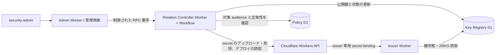

---
sidebar:
  label: Rotation Controller
---

# 管理画面からの鍵生成と自動ローテーション

**状態:** 実装済み。Rotation Controller（`apps/rotation-worker`）は RPC メソッド `listKeys`、`plan`、`propose`、`approve`、`control`、`immediateActivate`、`configureSchedule`、`activate`、`retire` を提供する。Workflow は secret のアップロード、JWK の先行公開、待機、デプロイと relying party のゲートの検証、切替、旧鍵の削除を順に実行する。[目標とする Controller の状態機械](#目標とする-controller-の状態機械) の詳細な状態は引き続き目標設計であり、Cloudflare API、`jose`、RSA/EC 鍵生成の経路は実アカウントでの試験を要する。

rotation run は `draft`、`secret-staging`、`published`、`active`、`removed`、`failed` の状態を使い、鍵は `prepared`、`active`、`verifying`、`removed` を使う。Workflow の実行状態は鍵の状態と別に表示する。

## 結論と境界

管理画面は「鍵ローテーションを開始」（または「鍵ローテーションを提案」）、「鍵を生成して開始」、「定期ローテーションを有効にする」を提供する。これらはサーバー側のジョブを起動する操作であり、ブラウザーは秘密鍵を生成・受信・表示しない。

鍵生成には Workers Web Crypto の `generateKey()` を使える。生成した秘密鍵を issuer Worker の secret として登録するには一度 export して Cloudflare API へ送る必要があるため、この設計は「鍵が一度も export されない」とは保証できない。非エクスポート鍵が必須なら、署名処理を外部 KMS の `Sign` アダプタに置き換える。[Workers Web Crypto](https://developers.cloudflare.com/workers/runtime-apis/web-crypto/)、[Worker Secrets API](https://developers.cloudflare.com/api/resources/workers/subresources/scripts/subresources/secrets/methods/update/) を参照する。

## 構成

- **Admin Worker:** 運用者の認証、RBAC、承認の記録、ジョブ状態の表示を担う。Worker 更新用の API token、秘密鍵、Key Registry D1 Binding を持たない。管理画面は任意の鍵材、account/script 名、Cloudflare API の request body を送れない。
- **Rotation Controller:** 固定の `ctx.props` が `{ "caller": "admin" }` である Service Binding 経由の RPC だけを受け付け、公開 HTTP handler は 404 を返す。この props は呼出元がその binding を持つことを示すだけで、呼出元が Admin Worker であることは証明しない。生成されるステージング設定では、テストのために smoke Worker もこの binding を受け取る。本番ではこの binding を Admin Worker にだけ与える。Policy D1 を読み、Key Registry D1 に書き、Workflow を起動する。許可アルゴリズム、待機時間、同時実行、`kid` の生成を入力スキーマと状態の前提条件で制約する。定期実行は固定の 5 分間隔の Worker Cron Trigger で評価する。
- **Key Registry D1:** 公開 JWK、`kid`、`alg`、secret binding 名、状態、公開時刻・切替時刻、デプロイバージョン、run ID、ゲートの証拠の正本である。issuer と Controller だけが Binding を持つ。Admin Worker は Controller の `listKeys` RPC で公開情報を読む。秘密鍵や Cloudflare API token は格納しない。
- **Issuer Worker:** 現在のポリシーと鍵状態を読み、実際の秘密鍵は自分の secret binding からのみ取得し、JWKS を Registry から作る。読取エラーや鍵の不一致では新規発行を拒否する。

対象の script はコード上で `CF_ISSUER_SCRIPT` 設定により固定され、Controller はその script 配下の Cloudflare API パスだけを呼ぶ。ただし API token 自体はその Worker に限定されない。ステージング手順は account 単位の **Workers Scripts Edit** と **Read** 権限を持つ token を求める。この token は account 内の任意の Worker を更新できる権限に相当する高権限な資格情報として扱い、Cloudflare が許す範囲でさらに権限を絞る。

secret をアップロードすると、issuer の新しいバージョンが作られてデプロイされる。Controller はデプロイメント API でデプロイメントを作成・変更しない。デプロイメントとバージョンは読み取るだけ（`GET deployments`、`GET versions`）であり、単一のバージョンが 100% で配信され、新鍵の binding を持つことを検証する。廃止では旧 secret を削除するだけである。検証を通るまで Registry の `active` を旧鍵のまま保つことで、秘密鍵の用意と新鍵での署名開始を分離する。通常のデプロイとローテーションを調停する。[Worker Secrets API](https://developers.cloudflare.com/api/resources/workers/subresources/scripts/subresources/secrets/methods/update/) を参照する。

## 管理画面の操作と状態

管理画面は鍵、run、ゲートの証拠、操作履歴を表示し、次の操作を提供する。開始、承認、制御、スケジュール設定、即時ローテーションには step-up 認証（Cloudflare Access）または直近の認証（パスキー）が必要である。提案には不要である。

| 操作・表示             | 権限                                                                      | 振る舞い                                                                                                                                                                                                 |
| ---------------------- | ------------------------------------------------------------------------- | -------------------------------------------------------------------------------------------------------------------------------------------------------------------------------------------------------- |
| ローテーションの開始   | `security-admin`                                                          | `plan` が直接 run を作る。計画はアルゴリズム、`prepublishSeconds`（60～2,592,000）、`retirementGraceSeconds`（300～2,592,000）を指定する。                                                               |
| 提案と承認             | `operator` または `security-admin` が提案し、別の `security-admin` が承認 | `propose` が計画を保存し、`approve` が run を作る。承認者は提案者以外の `security-admin` でなければならない。`security-admin` は提案を経ずにローテーションを直接開始することもできる。                   |
| 一時停止・再開・再試行 | `security-admin`                                                          | `control` は理由を必須とする。`removed`、`failed`、`secret-staging` の run には拒否する。再試行は errored または terminated の Workflow の再起動、または `draft` の run で欠けた Workflow の起動に限る。 |
| 自動化の設定           | `security-admin`                                                          | `configureSchedule` が [自動化の設定](#自動化の設定) の項目を設定する。既定は無効である。                                                                                                                |
| 即時ローテーション     | `security-admin`                                                          | `immediateActivate` は公開済みの候補、その `kid`、理由、キャッシュの危険を受け入れる明示的な確認を必須とする。                                                                                           |
| 履歴の表示             | `viewer` 以上                                                             | 鍵、run、Workflow の状態、スケジュール、提案、ゲートの証拠、操作を表示する。                                                                                                                             |

`secret-staging` に留まった run は、secret のアップロード結果が不明なため再試行できない。2 回目の鍵アップロードではなく、手動での復旧を要する。鍵の作成前に認証拒否（HTTP 401 または 403）が確定した場合は run を `failed` とする。token を修正して新しいローテーションを開始する。

「生成成功」は secret のアップロードと公開鍵の登録の両方が完了した状態を指す。「ローテーション成功」は発行・JWKS・relying party の検証をすべて通過した状態を指す。ボタンの押下や D1 の作業記録だけで成功としない。

## 自動化の設定

スケジュールのスキーマはアルゴリズムごとに次の項目を持つ。

| 項目                     | 制約                               |
| ------------------------ | ---------------------------------- |
| `algorithm`              | `RS256` または `ES256`             |
| `enabled`                | 真偽値。既定は無効                 |
| `intervalDays`           | 7～365                             |
| `nextRunAt`              | 有効化する時は現在から 60 秒以上先 |
| `prepublishSeconds`      | 60～2,592,000                      |
| `retirementGraceSeconds` | 300～2,592,000                     |

通知先と、定期実行の承認要否の設定は実装されておらず、将来の作業である。

スケジュールの有効化には、そのアルゴリズムの現用鍵、それを使う audience が 1 つ以上あること、そしてその全 audience について JWKS キャッシュ上限の記録、`prepublishSeconds` が上限に 60 秒を加えた値以上であること、relying party の確認が必要である。tick ごとに scheduler は、`removed` でも `failed` でもない run があるアルゴリズムをスキップする。確認が満たされなくなった場合、scheduler はスケジュールを無効化し、理由をスケジュールと操作履歴に記録して構造化ログを出力する。管理画面はその理由を表示する。D1 への run の登録と次回実行時刻の更新は同一 batch で行う。Workflow の作成前に停止した場合も同じ run ID で回復する。

## 目標とする Controller の状態機械

以下は回復性と可観測性を高めるための目標設計であり、現行の run の状態を表すものではない。完成形では `draft → secret-staged → published → issuer-deployed → cache-wait → active → retiring → removed` とする。各遷移は期待する前状態と一意なジョブ ID を条件に更新する。未完了ジョブがある `alg` の新規ジョブは拒否し、手動開始と定期実行が同時に走っても二重に切り替えない。

`published` から `removed` まで旧・新の公開鍵を JWKS に併記する。新規署名に使う鍵は `active` への切替時に 1 回だけ移す。先行公開期間と切替後の旧鍵保持期間は別々に設定・検証し、実際の移行期間が延びても旧鍵を早く削除しない。[公開鍵の移行期間](./key-management.md#公開鍵の移行期間) を参照する。

1. Web Crypto で鍵を生成する。RS256 は 3072 bit の RSA、ES256 は P-256 とする。`kid` と binding 名は Controller が新規に割り当てる。秘密鍵の export とアップロードはサーバー側で行い、ログ・Workflow の payload/step result・D1・ブラウザーに秘密成分を残さない。Cloudflare API の成功後に障害が起きた場合は、同じ `kid` に別の鍵を上書きせず、候補を照合または破棄して新しい `kid` で再試行する。
2. `published` に進め、JWKS に新旧の公開鍵が見えることを外部 HTTPS から検査する。旧鍵による発行を続ける。
3. 新 secret を含む Worker バージョンが 100% で配信されていることを確認し、実行時の鍵ペアを検証する。通常のコードデプロイが重なったら停止する。
4. Policy D1 から対象 `alg` を使う全 audience を読み、relying party ごとに確認済みの混合 JWKS とキャッシュ待機を満たす。切替直前に audience の集合とバージョンを読み直す。未検証の新しい audience、監視の欠落、JWKS の不一致、デプロイ状態の不明は自動切替を止める。
5. 条件付きの D1 transaction で新鍵を `active`、旧鍵を `verifying` にし、マニフェストの revision を進める。JWKS と発行が中途半端な状態を観測しないことを統合テストで示す。発行された `kid` と外部交換を監視し、異常時は両方の公開鍵を残したまま安全な署名状態へ戻す。
6. 予約の期限と切替 transaction の並行制御から、旧鍵による最終発行の保守的な上界を確定する。その上界に最大 JWT 有効期間と時刻ずれを加えた時刻の後にだけ旧公開鍵を外し、旧 secret を削除する。上界を検証できない場合は手動での削除を求める。

複数時間の待機と再試行には Cloudflare Workflows を使う。Workflows は `sleep` とステップごとの再試行を持つが、秘密鍵をステップの戻り値や永続状態に含めない。Cloudflare API 呼び出しと D1 更新は 1 つの分散 transaction ではないため、各ステップを冪等にし、孤立した secret やバージョン、公開だけされた鍵、デプロイだけされた鍵を回復時に検出する。[Workflows](https://developers.cloudflare.com/workflows/)、[sleep と retry](https://developers.cloudflare.com/workflows/build/sleeping-and-retrying/) を参照する。

## 目標とする自動化の有効化条件

定期実行と自動化の設定は実装済みである。次の項目は引き続き本番リリースのゲートである。

- 初期モードは **manual** とする。relying party が実機で混合 JWKS、再取得、キャッシュ上限、切替後の交換の試験を通過した `alg` だけ自動ローテーションを有効にする。
- スケジュールは固定の 5 分間隔の Worker Cron Trigger で動く。各アルゴリズムの周期、次回実行、有効状態は Key Registry D1 に置き、管理画面は Cloudflare の cron 設定を書き換えない。実行日時は UTC で記録し、運用上の期限より十分前に準備を始める。[Workflow schedules](https://developers.cloudflare.com/workflows/build/trigger-workflows/) を参照する。
- 自動化は生成・先行公開・切替・廃止の各ゲートを通る。証拠が欠ければジョブを止め、旧鍵での発行を続ける。漏えいが疑われる場合の緊急ローテーションは別の手順とする。
- Controller token の漏えいや悪用は issuer の偽装や停止につながり得る。token の保管、権限範囲、監査、緊急失効、定期交換を本番リリースのゲートとする。

## 本番運用前に実証すること

1. Workers での RSA 3072 bit と P-256 の生成時間・CPU 使用量、`jose` との JWK 互換性。
2. secret のアップロードと削除の後の Worker バージョン作成とデプロイの挙動。`secret_key` binding も試験するが、初期設計では必須としない。
3. Key Registry D1 の更新から全公開 JWKS 応答と次の発行への反映時間、読取障害時に fail closed となる挙動。
4. Cloudflare が許す最も狭い Controller token の範囲、通常の CI デプロイとの排他、Cloudflare API の監査可能性。
5. Workflow の再試行・中断・重複実行から、秘密鍵を永続化・ログ出力せずに回復できること。
6. 並行する切替の中で旧鍵発行の上界を実証できること、確定できない場合に自動削除を止めること。

## 即時ローテーションの境界

即時ローテーションは、先行公開の待機、audience のキャッシュ検査、relying party の確認の検査（交換、混合 JWKS、ES256 の確認）を省略する。デプロイと JWKS の検証、旧鍵の廃止ゲートは省略しない。relying party が交換済みの資格情報は失効しない。一時停止中の Workflow は、即時ローテーションの後も明示的な再開を要する。

## audience の確認を切替条件にする

relying party の確認は audience の `exchange_verified`、`mixed_jwks_verified`、`jwks_cache_seconds` に保持する。自動化と通常の鍵交換には、対象アルゴリズムを使う全 audience について認証成功と新旧鍵の受理の確認、十分なキャッシュ待機が必要である。ES256 は専用の確認も要する。確認はスケジュールの有効化時と各 tick で行い、通常の切替はデプロイ確認の前後で現在の確認を読み直す。Controller 自身は外部への token exchange を実行しない。

アルゴリズムの最初の鍵は、旧鍵がないため新旧鍵の確認が適用されず、relying party の試験前に有効化できる。キャッシュ上限の検査は適用され、自動化には引き続き現用鍵が必要である。
