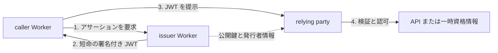
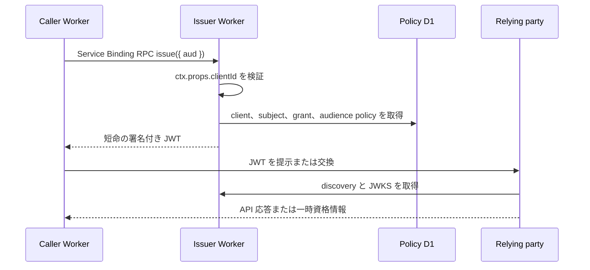

`workers-workload-identity` は、人ではなく Cloudflare Worker に ID を与えます。caller Worker は短命の署名付き JWT を取得し、外部クラウドの token exchange または独自 API へ提示します。この JWT を本文では**[ワークロードアサーション](./reference/glossary.md#アサーションと鍵)**と呼びます。

このソフトウェアは、issuer と JWKS の所在を示す限定的なメタデータを公開するワークロードアサーション issuer です。ブラウザーログインを提供する OpenID Provider ではありません。

## このリポジトリ固有の制約

:::warning
**発行要求元の Worker が、意図した Worker そのものであることは検証されません。** issuer は Service Binding に設定された `ctx.props.clientId` を識別情報として扱います。`clientId` は秘密ではなく、Worker 名やコードの真正性を証明するものでもありません。別の Worker に他者の `clientId` を設定してデプロイできる主体がいれば、その client として発行を要求できます。
:::

issuer は、受け取った `clientId` について登録・有効状態と audience の許可を検査します。ただし、その認可判定は **Binding の設定を信頼できることが前提**です。Cloudflare の Worker 編集・デプロイ権限、Service Binding と `props` の変更権限、CI や API token を管理し、発行を有効にする前に、信頼できない主体が別の client の ID を設定できないことを利用環境で実証してください。複数ロールや API token による設定権限の実機評価は未完了です。

この図の信頼境界はデプロイ権限まで含みます。信頼できないコードに発行用 RPC stub を渡したり、公開 HTTP handler から動的な `props` を持つ loopback binding で発行を呼び出したりしないでください。

そのほか、導入前に確認すべき制約は次のとおりです。

| 制約                                             | 意味と必要な対応                                                                                                                                                                                                                                                                        |
| ------------------------------------------------ | --------------------------------------------------------------------------------------------------------------------------------------------------------------------------------------------------------------------------------------------------------------------------------------- |
| **発行済み JWT は即時回収できない**              | client 停止や grant 解除は新規発行を止めますが、発行済み JWT は期限まで利用される可能性があります。交換済み資格情報も relying party 側の期限に従います。緊急時は relying party 側の信頼・権限・セッションも停止してください。                                                           |
| **JWT の再利用を自動では防げない**               | JWT は所持者が使える bearer credential です。`jti` だけでは再提示を防げません。必要なら relying party で使用済み ID の管理などを実装してください。                                                                                                                                      |
| **relying party の認可と資格情報交換は別途必要** | issuer の発行許可は、リソースへのアクセス許可ではありません。relying party で issuer・`sub`・`aud` などを検証し、権限を設定してください。プロバイダーごとの交換 SDK は含まれません。                                                                                                    |
| **JWT の形式と発行経路が限定される**             | 発行は同一 Cloudflare account 内の Service Binding RPC に限られます。caller は任意の subject、クレーム、有効期間、署名アルゴリズムを指定できません。有効期間は 1〜300 秒で、relying party の要件と合わない場合があります。                                                              |
| **外部接続と本番運用は未検証**                   | 外部プロバイダーとの交換、デプロイ権限の分離、本番の監視・復旧などは受け入れが完了していません。現在はアルファ版のため、評価環境にだけデプロイしてください。[リリース状況](./reference/release-status.md)と[プロバイダー対応状況](./reference/provider-support.mdx)を確認してください。 |
| **完全な OIDC Provider ではない**                | discovery と JWKS を公開しますが、ブラウザーログインや一般的な OAuth/OIDC のフロー、OpenID Federation 1.1 の信頼チェーンは提供しません。                                                                                                                                                |

詳細な脅威と運用上の対策は[セキュリティモデル](./reference/security.md)と[運用ガイド](./guides/operations.md)を参照してください。

## ワークロード ID フェデレーションの仕組み

ワークロード ID フェデレーションは、あるシステムが発行したワークロードの ID を、別のシステムが検証して受け入れる仕組みです。ここでは、事前に issuer を信頼するよう設定した relying party に、Worker が短命の JWT を提示します。relying party は署名とクレームを検証し、許可されたワークロードであれば API を利用させるか、一時資格情報を発行します。

relying party には、受け入れる issuer、subject、audience を事前に設定します。公開鍵を取得できるだけでは、その issuer やワークロードを信頼したことにはなりません。

### 具体例: Worker から外部クラウドのリソースを使う

例えば、Worker が外部クラウドのストレージを読み取る場合、運用者は relying party に issuer と許可する subject を登録します。Worker は必要なときに JWT を取得して relying party へ提示し、返された一時資格情報でストレージにアクセスします。JWT を独自 API に直接提示する構成もあります。交換の手順や設定は relying party によって異なります。

:::warning
この例は仕組みの説明です。外部プロバイダーとの資格情報交換はまだ検証されておらず、対応を保証するものではありません。[プロバイダー対応状況](./reference/provider-support.mdx)を確認してください。
:::

## 導入するメリットと注意点

| メリット                             | 効果と前提                                                                                                                        |
| ------------------------------------ | --------------------------------------------------------------------------------------------------------------------------------- |
| 長期資格情報を caller に配らずに済む | relying party が短命 JWT や一時資格情報を受け入れる場合、固定の API キーなどを各 Worker に保管・更新する負担を減らせます。        |
| 漏えい時の利用可能時間を短くできる   | 本プロジェクトの JWT は最長 5 分です。ただし有効期間中の再利用は防げず、交換後の資格情報は relying party の期限に従います。       |
| ワークロードと用途を分けられる       | issuer は caller に対応する subject と許可済み audience を設定します。relying party でも subject ごとに権限を絞る必要があります。 |
| 発行の管理を集約できる               | 発行ポリシーや署名鍵の運用を issuer にまとめられます。一方、issuer の運用とデプロイ権限の保護が重要になります。                   |

短命の JWT も所持者が利用できる資格情報です。ログに記録せず、デプロイ権限と relying party の認可を適切に管理してください。詳細は[セキュリティモデル](./reference/security.md)を参照してください。

## OIDC で relying party が公開鍵を見つけられるようにする

外部の relying party は、次の公開 HTTP エンドポイントから issuer と署名鍵を確認します。

| エンドポイント                          | 内容                                                                    | キャッシュ   |
| --------------------------------------- | ----------------------------------------------------------------------- | ------------ |
| `GET /.well-known/openid-configuration` | issuer、JWKS URL、クレーム・subject・署名アルゴリズムの互換性メタデータ | `max-age=60` |
| `GET /jwks.json`                        | `removed` 以外の RSA または P-256 EC 公開鍵                             | `max-age=60` |

発行は公開 HTTP では提供しません。caller は同じ Cloudflare account 内の Service Binding から名前付きエントリポイント `IssuerRpc` を呼び出します。これにより、インターネットからアサーションを発行する経路を持たずに、外部の relying party には検証に必要な情報だけを公開できます。

:::warning
`response_types_supported: ["id_token"]` は AWS IAM の互換性要件に合わせた項目です。認可エンドポイントや OIDC の ID Token 発行を提供することを意味しません。公開メタデータは OIDC Discovery の必須項目をすべては含まず、OIDC Discovery に準拠していません。完全な OpenID Provider のメタデータを要求する relying party では利用できません。相互運用性は relying party ごとに試験する必要があります。
:::

## caller、issuer、relying party の役割

caller が指定できるのは希望する `aud` だけです。issuer は Service Binding に固定された `clientId` から `sub` と許可済み audience を引き、発行のたびにポリシーを評価します。caller は `sub`、有効期間、署名アルゴリズム、`kid`、追加クレームを上書きできません。

## JWT は7つのクレームに限定する

署名済み JWT の JOSE header は `alg`、`kid`、`typ: "JWT"` を持ちます。payload は次のクレームに限定しています。

| Claim | 値の決まり方                                   |
| ----- | ---------------------------------------------- |
| `iss` | issuer の設定値 `ISSUER_URL`                   |
| `sub` | client registry に保存した固定 subject         |
| `aud` | caller が要求し、grant と完全一致した audience |
| `iat` | 発行時刻                                       |
| `nbf` | `iat` と同じ時刻                               |
| `exp` | audience policy の有効期間。1〜300秒           |
| `jti` | 発行ごとに生成する UUID                        |

署名アルゴリズムは audience ごとに `RS256` または `ES256` を固定します。`RS256` が初期の既定で、`ES256` は relying party との相互運用性の試験を記録した audience だけが使用できます。[署名アルゴリズムと鍵ライフサイクル](./design/key-management.md)を参照してください。

`jti` は一意な識別子ですが、それだけで再利用を防ぐことはできません。再提示を拒否する必要がある relying party は、使用済み `jti` を保持するなどの仕組みを別途実装します。

## 対象外の機能

初期版は次の機能を提供しません。

- エンドユーザーのログイン、同意画面、セッション管理
- authorization endpoint、公開 token endpoint、UserInfo endpoint
- 認可コード、Device Authorization、Refresh Token の各フロー
- 任意の OAuth scope やユーザー属性を含む ID Token の発行
- Dynamic Client Registration
- OpenID Federation 1.1 の entity statement と trust chain
- 外部クラウド固有の資格情報交換 SDK

OpenID Federation 1.1 と、クラウド各社が「workload identity federation」と呼ぶ仕組みは別です。本プロジェクトは後者のための短命 JWT を発行します。

## 信頼は署名だけでは成立しない

relying party は署名に加えて `iss`、`aud`、`sub`、時刻、有効期間、許可アルゴリズムを検証しなければなりません。issuer の公開鍵で署名されているだけでは、対象 API を呼ぶ権限があるとは判断できません。

caller の `ctx.props.clientId` も秘密情報ではありません。Service Binding と `props` を変更できる Cloudflare のデプロイ主体は別の client ID を設定できるため、Worker と API token のデプロイ権限を信頼境界に含めます。詳しくは[セキュリティモデル](./reference/security.md)を参照してください。

## 相互運用性はプロバイダーごとに確認する

Worker 間の発行・拒否・検証は、ローカル workerd と Cloudflare ステージングで確認済みです。AWS、Google Cloud、Claude API、OpenAI API、Microsoft Entra との資格情報交換は未確認であり、現時点ではサポート対象と表明していません。最新の結果は[プロバイダー対応状況](./reference/provider-support.mdx)に集約します。

実際に試す場合は[クイックスタート](./getting-started.mdx)、既存 caller を接続する場合は[issuer と caller の設定](./guides/configuration.md)へ進んでください。
