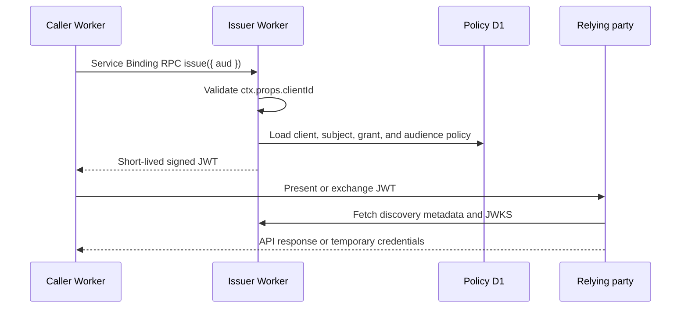

`workers-workload-identity` gives an identity to a Cloudflare Worker rather than to a person. A caller Worker obtains a short-lived, signed JWT and presents it to an external cloud token exchange or a private API. This documentation calls that JWT a **[workload assertion](./reference/glossary.md#assertions-and-keys)**.

The software is a workload assertion issuer that publishes limited issuer and JWKS location metadata. It is not an OpenID Provider for browser login.

## Limitations specific to this repository

:::warning
**The issuer does not independently verify that the requesting Worker is the intended Worker.** It identifies the caller using `ctx.props.clientId` configured on the Service Binding. The client ID is not secret and does not attest to the Worker's name or code. Anyone able to deploy another Worker with someone else's client ID can request issuance as that client.
:::

The issuer checks whether the supplied client is registered and enabled and whether its audience is granted. That authorization decision **depends on trusting the Binding configuration**. Restrict and verify Cloudflare Worker editing and deployment permissions, Service Binding and `props` changes, CI, and API tokens in your environment. Demonstrate that untrusted principals cannot configure another client's ID before enabling issuance. The practical evaluation of configuration permissions across roles and API tokens remains incomplete.

The trust boundary in this diagram includes deployment permissions. Do not pass the issuance RPC stub to untrusted code or invoke issuance from a public HTTP handler using a loopback binding with dynamically supplied `props`.

Also assess these constraints before deployment:

| Constraint                                                            | Effect and required action                                                                                                                                                                                                                                                                                |
| --------------------------------------------------------------------- | --------------------------------------------------------------------------------------------------------------------------------------------------------------------------------------------------------------------------------------------------------------------------------------------------------- |
| **Issued JWTs cannot be immediately recalled**                        | Disabling a client or removing a grant stops new issuance, but an issued JWT may remain usable until expiry. Exchanged credentials follow the relying party's lifetime. In an emergency, disable the relying party's trust, permissions, and sessions as well.                                            |
| **JWT replay is not automatically prevented**                         | A JWT is a bearer credential. A `jti` alone does not prevent reuse; implement a consumed-ID store or another mechanism at the relying party if needed.                                                                                                                                                    |
| **Relying-party authorization and credential exchange are separate**  | Issuance permission does not grant access to a resource. The relying party must validate the issuer, `sub`, `aud`, and other claims and configure permissions. Provider-specific exchange SDKs are not included.                                                                                          |
| **JWT format and issuance path are restricted**                       | Issuance uses Service Binding RPC within the same Cloudflare account. Callers cannot choose arbitrary subjects, claims, lifetimes, or signing algorithms. The 1–300 second TTL may not meet every relying party's requirements.                                                                           |
| **External interoperability and production operation are unverified** | Provider exchanges, deployment-permission isolation, and production monitoring and recovery have not completed acceptance. The project is in alpha; deploy only to evaluation environments. See [release status](./reference/release-status.md) and [provider support](./reference/provider-support.mdx). |
| **Not a complete OIDC Provider**                                      | The issuer publishes discovery and JWKS but does not provide browser login, general OAuth/OIDC flows, or OpenID Federation 1.1 trust chains.                                                                                                                                                              |

See the [security model](./reference/security.md) and [operations guide](./guides/operations.md) for detailed threats and mitigations.

## How workload identity federation works

Workload identity federation lets one system verify and accept a workload identity issued by another. Here, a Worker presents a short-lived JWT to a relying party configured in advance to trust the issuer. The relying party verifies the signature and claims, then authorizes the workload to use an API or issues temporary credentials.

The relying party must be configured in advance with the issuer, subjects, and audiences it accepts. The ability to fetch a public key does not by itself establish trust in an issuer or authorize a workload.

### Example: a Worker accessing external cloud storage

To let a Worker read cloud storage, an operator can register the issuer and an allowed subject with the relying party. The Worker obtains a JWT when needed, presents it to the relying party, and uses the resulting temporary credentials to access storage. Another arrangement is to present the JWT directly to a private API. Exchange procedures and configuration differ by relying party.

:::warning
This example illustrates the flow; external provider credential exchange has not yet been verified and support is not guaranteed. Check [provider support](./reference/provider-support.mdx) for the current status.
:::

## Benefits and considerations

| Benefit                                              | Effect and conditions                                                                                                                                 |
| ---------------------------------------------------- | ----------------------------------------------------------------------------------------------------------------------------------------------------- |
| Avoid distributing long-lived credentials to callers | When a relying party accepts short-lived JWTs or temporary credentials, Workers need not each store and rotate a fixed API key or similar credential. |
| Limit the window of exposure                         | This project's JWTs last at most five minutes. They can still be replayed while valid, and exchanged credentials follow the relying party's lifetime. |
| Separate workloads and intended uses                 | The issuer assigns a subject and permitted audiences to each caller. The relying party must also restrict permissions for each subject.               |
| Centralize issuance management                       | Issuance policies and signing-key operations can be managed at the issuer. Protecting the issuer and deployment permissions remains essential.        |

A short-lived JWT is still a bearer credential. Keep it out of logs and protect deployment permissions and relying-party authorization. See the [security model](./reference/security.md).

## OIDC lets relying parties discover the public keys

An external relying party uses two public HTTP endpoints to identify the issuer and obtain its signing keys.

| Endpoint                                | Contents                                                                           | Cache policy |
| --------------------------------------- | ---------------------------------------------------------------------------------- | ------------ |
| `GET /.well-known/openid-configuration` | Issuer, JWKS URL, and claim, subject, and signing-algorithm compatibility metadata | `max-age=60` |
| `GET /jwks.json`                        | RSA or P-256 EC public keys in any state except `removed`                          | `max-age=60` |

Issuance is not available over public HTTP. A caller invokes the named `IssuerRpc` entrypoint through a Service Binding in the same Cloudflare account. This design exposes only the information an external relying party needs for verification and leaves no Internet-facing endpoint that can issue assertions.

:::warning
The `response_types_supported: ["id_token"]` field is present for AWS IAM compatibility. It does not mean that this issuer provides an authorization endpoint or issues OIDC ID Tokens. The metadata omits required OIDC Discovery fields and is not OIDC Discovery compliant. Relying parties that require complete OpenID Provider metadata cannot use it. Interoperability must be tested with each relying party.
:::

## Caller, issuer, and relying party

The caller controls only the requested `aud`. The issuer looks up the `sub` and the allowed audiences from the `clientId` fixed in the Service Binding, then evaluates the policy for every issuance. A caller cannot override the subject, lifetime, signing algorithm, `kid`, or add claims.

## The JWT contains seven claims

The JOSE header contains `alg`, `kid`, and `typ: "JWT"`. The payload is limited to these claims:

| Claim | Source                                                          |
| ----- | --------------------------------------------------------------- |
| `iss` | Issuer setting `ISSUER_URL`                                     |
| `sub` | Fixed subject stored in the client registry                     |
| `aud` | Audience requested by the caller and matched exactly by a grant |
| `iat` | Issuance time                                                   |
| `nbf` | The same instant as `iat`                                       |
| `exp` | Audience policy lifetime, from 1 to 300 seconds                 |
| `jti` | A UUID generated for each issuance                              |

Each audience fixes its signing algorithm to `RS256` or `ES256`. `RS256` is the initial default. `ES256` is available only when the audience records an interoperability test with its relying party. See the [key lifecycle specification](./design/key-management.md).

A unique `jti` does not prevent replay by itself. A relying party that must reject reuse needs an additional mechanism, such as a store of consumed token IDs.

## What this project does not implement

The initial release does not provide:

- end-user login, consent, or session management;
- authorization, public token, or UserInfo endpoints;
- Authorization Code, Device Authorization, or Refresh Token flows;
- ID Tokens carrying OAuth scopes or user attributes;
- Dynamic Client Registration;
- OpenID Federation 1.1 entity statements or trust chains; or
- provider-specific credential-exchange SDKs.

OpenID Federation 1.1 is distinct from what cloud providers call workload identity federation. This project issues short-lived JWTs for the latter.

## A valid signature is not sufficient authorization

A relying party must verify `iss`, `aud`, `sub`, time claims, maximum lifetime, and the algorithm allowlist in addition to the signature. A token signed by the issuer is not automatically authorized to call a particular API.

The caller's `ctx.props.clientId` is not a secret either. A Cloudflare deploy principal that can change a Service Binding and its `props` can select another client ID. Worker and API-token deployment permissions are therefore part of the trust boundary. See the [security model](./reference/security.md).

## Interoperability is verified per provider

Issuance, rejection, and verification between Workers have been tested in local workerd and in a Cloudflare staging environment. Credential exchange with AWS, Google Cloud, Claude API, OpenAI API, and Microsoft Entra has not been verified, so none is currently declared supported. [Provider support](./reference/provider-support.mdx) is the source of truth for test results.

Continue with the [Quickstart](./getting-started.mdx) to run the project, or [configure the issuer and caller](./guides/configuration.md) to connect an existing Worker.
